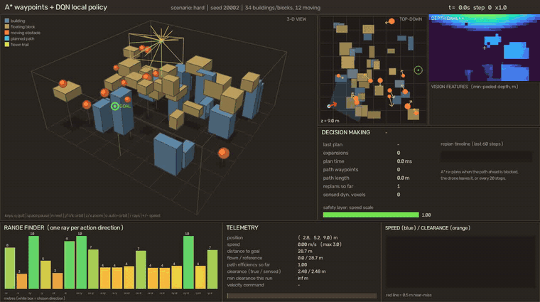
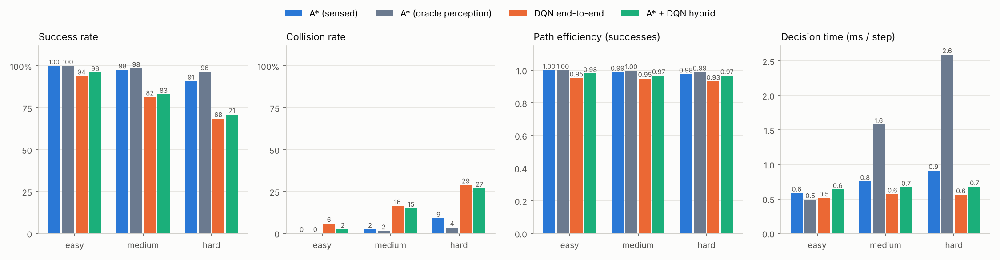
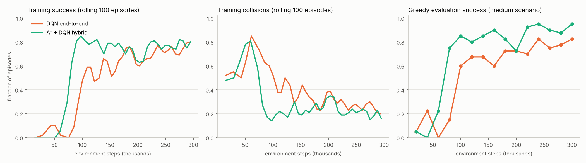

# Autonomous Drone Navigation in Dynamic 3-D Environments
### A* planning vs. deep reinforcement learning vs. a hybrid of both — a simulation study



*Hybrid agent (A\* way-points + DQN local policy) on a "hard" world: 34 buildings/floating blocks, 12 moving obstacles. Panels: 3-D orbit view, top-down map, the drone's depth camera with OpenCV detections, pooled vision features, Q-values of all 19 actions, range finder, telemetry.*

---

## 1. Problem

A quadrotor must fly from a start to a goal 20–30 m away inside a cluttered 32 × 32 × 12 m volume containing

* **static obstacles** — ground-anchored buildings and floating blocks,
* **dynamic obstacles** — spheres flying at 1.5–3 m/s, mostly *crossing* the start–goal corridor, with random wander and bounces off walls/buildings.

The drone has limited, noisy perception (a forward depth camera and 18 range-finder rays), inertia (6 m/s² acceleration limit — it cannot stop instantly), and must reach the goal **without touching anything** while flying a **short** path. We compare three ways of building such a controller:

| Agent | Global knowledge | How it avoids obstacles |
|---|---|---|
| **A\*** (baseline) | prior map of the *static* scene | replans on a voxel map that is updated online from sensor returns; reactive safety layer |
| **DQN end-to-end** | only "where is the goal" | learned, purely from sensors |
| **A\* + DQN hybrid** | A\* way-points on the static map | learned local policy follows the way-points and dodges what the map doesn't contain |

## 2. Approach

**Simulator** (`env/`, `agent/`). Custom NumPy ray-cast simulator; one control step = 0.1 s. Worlds are randomly generated and verified *solvable on the static map* (A\* must find a path with the safety margin). Camera is a 40×24 range image (100°×60° FOV, Gaussian noise + 0.5 % dropout); the 18 range-finder rays point along the 18 non-hover action directions, so "ray *k* length" literally means "how far can I fly if I pick action *k*".

**Vision** (`agent/vision.py`, OpenCV). `medianBlur` on the range image → threshold at 5 m → morphological opening → `connectedComponentsWithStats` → obstacle detections (bbox, nearest depth, bearing). A min-pooled 3×5 depth grid is the camera feature fed to the policy.

**A\* baseline** (`agent/astar.py`, `mapping.py`, `planner_agent.py`). Weighted 26-connected 3-D A\* (w = 1.2) on a 1 m voxel grid with 1 m obstacle inflation, followed by any-angle line-of-sight smoothing and pure-pursuit tracking. Dynamic obstacles are *sensed*: depth/range returns are back-projected to world coordinates; any return that does not lie on a known static surface blocks nearby voxels for 1.2 s. Replans when the path ahead is blocked, when off-path, or periodically. A safety layer caps speed at the stopping-distance limit √(2·a·d) and adds a small repulsion from nearby surfaces. An `astar_oracle` variant reads true obstacle positions (with constant-velocity prediction) as an upper bound on perception.

**RL** (`models/`, `env/rl_env.py`). Double + dueling + 3-step DQN, MLP 60→256→256→(V, A), Polyak target updates, Huber loss, cosine LR decay, 200 k replay. 19 discrete actions (hover + 18 velocity directions at 3 m/s). Observation (60-d): 18 ranges, their per-step change (reveals approaching obstacles), 15 OpenCV vision features, unit vector/distance to the guidance target, goal distance, velocity, altitude. Reward = potential-based progress (distance-to-go) − step cost − proximity penalty, with +15 goal / −15 collision. Training uses a **curriculum** (4→16 buildings and 0→4 moving obstacles at start; 6→28 and 0→8 by 60 % of training), 300 k steps, ≈30 min on 1 CPU core per policy.
*End-to-end*: the policy's target is the goal. *Hybrid*: the target is the point 4 m ahead on an A\* path through the static map (planned with 1.6 m clearance); moving obstacles are not in that map, so the policy must handle them.

## 3. Results

All numbers: **200 episodes per agent per scenario, identical worlds for all agents, seeds disjoint from training and from checkpoint selection**. Scenarios: easy = 14 static / 0 moving; medium = 24 / 6; hard = 34 / 12. Brackets are 95 % Wilson intervals on success.



| scenario | agent | success | collision | timeout | path eff. | time-to-goal (s) | min clearance (m) | ms/step |
|---|---|---|---|---|---|---|---|---|
| easy | A\* (sensed) | **100%** [98–100] | 0% | 0% | 1.00 | 10.3 | 0.89 | 0.59 |
| easy | A\* (oracle perception) | 100% [98–100] | 0% | 0% | 1.00 | 10.3 | 0.89 | 0.49 |
| easy | DQN end-to-end | 94% [90–97] | 6% | 0% | 0.95 | 12.4 | 0.86 | 0.51 |
| easy | A\* + DQN hybrid | 96% [92–98] | 2% | 2% | 0.98 | 12.0 | 1.00 | 0.64 |
| medium | A\* (sensed) | **98%** [94–99] | 2% | 0% | 0.99 | 10.8 | 0.59 | 0.75 |
| medium | A\* (oracle perception) | 98% [96–99] | 2% | 0% | 1.00 | 10.7 | 0.64 | 1.58 |
| medium | DQN end-to-end | 82% [76–86] | 16% | 2% | 0.95 | 13.0 | 0.47 | 0.57 |
| medium | A\* + DQN hybrid | 83% [77–88] | 15% | 2% | 0.97 | 13.1 | 0.62 | 0.67 |
| hard | A\* (sensed) | 91% [86–94] | 9% | 0% | 0.98 | 11.5 | 0.44 | 0.91 |
| hard | A\* (oracle perception) | **96%** [93–98] | 4% | 0% | 0.99 | 11.2 | 0.55 | 2.59 |
| hard | DQN end-to-end | 68% [62–75] | 29% | 2% | 0.93 | 14.3 | 0.28 | 0.56 |
| hard | A\* + DQN hybrid | 71% [64–77] | 27% | 2% | 0.97 | 13.5 | 0.39 | 0.67 |

*Path efficiency* = shortest static-map path (smoothed A\*) ÷ distance flown, clipped to 1, successes only. *ms/step* = wall-clock of one `act()` call on a CPU (vision + planning/inference). Full per-episode data: `runs/eval/episodes.csv`.



### What the numbers say

* **The A\* baseline is the strongest agent in every scenario** — but it is also the best informed: it has a prior map of the buildings and a hand-designed safety layer, whereas the RL policies have neither. This is not an equal-information comparison and should not be read as "classical planning beats RL".
* **A\* + DQN hybrid vs. end-to-end DQN.** Giving the policy A\* way-points mainly helps where the problem is static: on *easy*, collisions fall from 6 % to 2 %, paths are shorter (0.98 vs 0.95 efficiency), and training reaches high success ≈ 2× sooner (curves above). With moving obstacles the two are statistically indistinguishable (83 % vs 82 %, 71 % vs 68 %; intervals overlap heavily) — dodging dynamic obstacles is the bottleneck for both learned policies, and it is not helped by global guidance.
* **Dynamic perception costs A\* little in the mean, more in the tail.** Replacing sensed obstacles with ground truth lifts A\* hard-scenario success from 91 % to 96 % (collisions 9 % → 4 %) at ≈3× the compute: remaining A\* failures are largely perception/prediction errors (a sensed obstacle's velocity is not estimated).
* **Compute**: every agent decides in ≈0.5–3 ms on one CPU core, well inside the 100 ms control period.

### Iteration history (honest accounting)

1. *First run* (constant LR, 1.0 m guidance margin, 20-episode checkpoint selection): the best checkpoints scored 95 % / 80 % on the 20-episode selection set but only **74 % (RL) and 67 % (hybrid) on medium** on fresh seeds (100 episodes, `runs/eval_v1`) — a combination of selection noise and late-training instability (greedy success oscillated 55–95 % between checkpoints). The hybrid was *worse* than end-to-end, and collided with static buildings even in the easy scenario.
2. *Diagnosis → fixes*: the hybrid's way-points hugged building corners (1 m clearance), too tight for a policy with inertia and discrete actions → guidance margin raised to 1.6 m. Cosine learning-rate decay (5e-4 → 5e-5) and a 40-episode selection set to stabilise training. Result: the numbers above.

The v2 learning curves (above) are still noisy; no hyper-parameter search beyond these two changes was done, and one training seed per agent was run.

## 4. Limitations / threats to validity

* Single training seed per learned agent; a different seed could move the learned-agent numbers by several points.
* Checkpoint choice used a held-out *selection* set, but "best of N evaluations" still carries a small optimistic bias; benchmark seeds are disjoint from it.
* The A\* baseline has privileged static-map knowledge; the RL agents do not. The hybrid shares that knowledge only through way-points.
* Simplified physics (point-mass with velocity commands, no wind, no attitude dynamics), perfect state estimate, spherical moving obstacles with simple reflect-and-wander motion, scenarios generated from one distribution.
* The 4 % residual A\* failures with oracle perception were not analysed per cause; collision *type* (static vs. dynamic) is not logged.

## 5. Future work

* Estimate obstacle velocities (tracking on OpenCV detections, optical flow on depth) and plan with predicted trajectories / velocity obstacles; feed estimates to the policy.
* Continuous-action actor-critic (SAC/TD3) and recurrent policies; frame stacking to remove the "one-step difference" crutch.
* Equal-information ablations: learn the map online (occupancy-grid input to the policy), or strip the A\* baseline's prior map.
* Safe RL: use the stopping-distance safety layer as a shield around the learned policy.
* Domain randomisation over sensor noise/obstacle speed; sim-to-real via PX4/AirSim or Gazebo.
* Multiple training seeds, population-based hyper-parameter search, and per-cause failure analysis.

## 6. Repository layout & usage

```
configs/default.yaml   every parameter (world, sensors, planner, RL, reward, viz)
env/                   raycast.py · world.py · generator.py · drone_env.py (physics env) · rl_env.py (discrete/reward wrapper)
agent/                 drone.py · sensors.py · vision.py (OpenCV) · astar.py · mapping.py · controller.py
                       planner_agent.py (A*) · guidance.py · features.py · rl_agent.py (DQN / hybrid)
models/                networks.py (dueling Q-net) · replay.py (n-step) · dqn.py · trainer.py
utils/                 config · logger · metrics · runner · plots · visualization (real-time viewer)
train.py  run_sim.py  evaluate.py   tests/ (pytest, 17 tests)
runs/                  trained checkpoints (train_*_v2), logs, benchmark outputs (eval/)
```

```bash
pip install -r requirements.txt

python run_sim.py --agent astar  --scenario hard                       # live window
python run_sim.py --agent hybrid --checkpoint runs/train_hybrid_v2/checkpoints/best.pt
python run_sim.py --agent rl     --checkpoint runs/train_rl_v2/checkpoints/best.pt --episodes 5
python run_sim.py --agent astar --no-display --video out.mp4 --snapshot frame.png   # headless

python train.py --mode rl     --name my_rl     --set rl.lr_end=5e-5 rl.eval_every=20000 rl.eval_episodes=40
python train.py --mode hybrid --name my_hybrid --set rl.lr_end=5e-5 rl.eval_every=20000 rl.eval_episodes=40
python evaluate.py --agents astar astar_oracle rl hybrid --episodes 200 \
    --rl-checkpoint runs/train_rl_v2/checkpoints/best.pt --hybrid-checkpoint runs/train_hybrid_v2/checkpoints/best.pt
python -m pytest -q tests
```

Any config value can be overridden: `--set world.size=[40,40,14] scenarios.hard.dynamic=16 planner.perception=oracle`. Live-window keys: `q` quit · `space` pause · `n` next episode · `j/l` `i/k` orbit · `z/x` zoom · `o` auto-orbit · `r` rays · `+/-` playback speed. Logs go to `runs/<name>/*.log` (console + file); training writes `train_log.csv` and `eval_log.json`; evaluation writes per-episode CSV, `summary.json`, `summary.md` and figures. All world generation is seeded, so results are reproducible (`DroneNavEnv.reset(seed=...)`).
